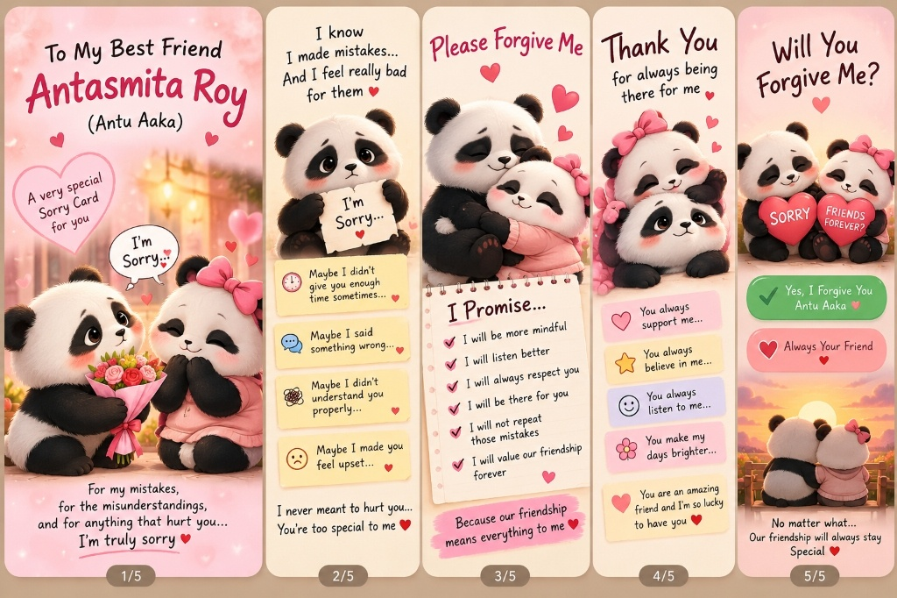

# To My Best Friend Antasmita Roy (Antu Aaka) 🐼❤️

An interactive, responsive 5-panel apology, promises, and forgiveness card web application.



## ✨ Features
- **💌 Interactive Wax-Sealed Envelope**: Tap the baby panda's letter to open, burst petals & sparkles, and start the music.
- **🎠 5 Story Cards with Mid-Card Sliding Controls**:
  1. *To My Best Friend Antasmita Roy (Antu Aaka)* - Flowers bouquet with falling rose petals.
  2. *I know I made mistakes...* - Sad baby panda with reflection sticky notes.
  3. *Please Forgive Me* - Hugging pandas with an interactive **"I Promise..."** checklist.
  4. *Thank You for always being there for me* - Cuddling pandas with gratitude pills.
  5. *Will You Forgive Me?* - Interactive acceptance buttons, runaway playful button, and sunset scene.
- **🎉 Forgiveness Celebration & Friendship Certificate**: Confetti cannon, fanfare, victory hug modal, and an official printable friendship certificate.
- **🎵 Zero-Dependency Web Audio Synthesizer**: Built-in gentle kalimba lullaby and cute sound effects (100% offline, zero CORS issues).
- **📱 100% Mobile-First**: Touch swipe gestures, tactile haptics (`navigator.vibrate`), dynamic viewport scaling, and no content cutoffs.
- **📑 Two Modes**: Switch between **Story Carousel** and **Panoramic All 5 Bookmarks** view with horizontal snap-scrolling.

## 🚀 Running Locally
Open `index.html` directly in any web browser, or run a local server:
```bash
python -m http.server 8085
```
Then visit `http://localhost:8085`.
